  <a href="https://saaketh-portfolio-mu.vercel.app"><b>Portfolio</b></a> &nbsp;·&nbsp;
  <a href="https://linkedin.com/in/saaketh-gadepalli-648a3b325">LinkedIn</a> &nbsp;·&nbsp;
  <a href="https://leetcode.com/u/saakethcse05/">LeetCode</a> &nbsp;·&nbsp;
  <a href="https://www.codechef.com/users/saakethcse05">CodeChef</a> &nbsp;·&nbsp;
  <a href="https://saaketh-portfolio-mu.vercel.app/Saaketh-Gadepalli-Resume.pdf">Résumé</a> &nbsp;·&nbsp;
  <a href="mailto:saakethcse05@gmail.com">Email</a>

I'm a Computer Science and Engineering student at Chennai Institute of Technology. I build machine-learning systems for medical imaging that point at the evidence behind each prediction, and I try to be strict about how they are evaluated: leak-audited splits, multiple seeds, confidence intervals, and a status table in every repository that says what was actually run and what was not.

 

## Selected work

  
  

  
  

**[OncoScan-AI](https://github.com/saaki05/oncoscan-ai)** puts three screening models behind one entry point. A router network picks the model for an unlabelled scan, Grad-CAM explains the prediction, and low-confidence cases are flagged for expert review. Research project, not a medical device.

**[LSM-tree store](https://github.com/saaki05/grandmaster)** is a storage engine with a write-ahead log, memtable, SSTables, Bloom filters, compaction and Raft replication, with no database library underneath.

**[City Insights](https://github.com/saaki05/chennai-insights-dashboard)** is a traffic dashboard on the real Chennai road network with DBSCAN hotspot detection and short-horizon forecasts, on a simulated feed. [See it live](https://saaki05.github.io/chennai-insights-dashboard/).

 

## Research engineering

Each study is three installable Python packages (data, model, service) with unit tests, CI, and a README that separates measured results from untested code paths.

| Study | Question | Finding, as measured |
|---|---|---|
| [**GraphShield**](https://github.com/saaki05/project-1-) | Is the gap between graph neural networks and gradient boosting on fraud detection real once splits are audited? | Tuned random forest (PR-AUC 0.912) beat GraphSAGE (0.876) on the Amazon fraud graph |
| [**PredictIQ**](https://github.com/saaki05/project-2) | Do conformal intervals for remaining useful life keep their coverage under shift? | Coverage fell from 0.890 to 0.858 from FD001 to FD002 on NASA C-MAPSS |
| [**PaperMind**](https://github.com/saaki05/project-3) | Which retrieval components beat BM25 on scientific claims? | Nothing tested beat default BM25 (nDCG@10 0.833) on SciFact |
| [**TerraVision**](https://github.com/saaki05/project-4) | How much do random tile splits inflate change-detection scores? | About 34 to 45% relative F1 inflation against a whole-area split on SpaceNet 7 |
| [**VisionForge**](https://github.com/saaki05/project-5) | Regression, adversarial or diffusion super-resolution on a fixed budget? | Plain L1 EDSR gained +1.87 dB over bicubic and beat both alternatives |

All five were trained on CPU only. GPU runs, more seeds and the remaining benchmarks are listed as open work in each README.

 

Also in the map: [AdhikarAI](https://github.com/saaki05/adhikar-ai), a civic-rights assistant built for the OOSC 4.0 hackathon; [SilentSync](https://github.com/saaki05/SilentSync), an offline sign, text and voice communication aid; and [BhoomiSetu](https://github.com/saaki05/bhoomisetu-app-), a farmer-to-buyer marketplace.

 

## Experience

- **AI/ML Developer, Fintech Centre of Excellence, Chennai Institute of Technology** (Dec 2025 to present). Explainable deep learning for diagnostics, and Flask inference APIs.
- **Software Development Intern, Siddi Vinayaka Mobikes Pvt. Ltd.** (Apr to Jun 2026). Built the browser-based vehicle movement tracker the dealership uses every day, on Google Sheets and Apps Script.
- **Organizer, AI Engineering Club, Chennai Institute of Technology.** Technical sessions and hackathon collaborations.

## Toolbox

- **Machine learning:** PyTorch, TensorFlow/Keras, scikit-learn, XGBoost, CNNs, U-Net, EfficientNet, transfer learning, Grad-CAM, attention
- **Language and vision:** Transformers, Hugging Face, OpenCV, image segmentation
- **Backend:** Flask, FastAPI, Express, Node.js, REST APIs, MySQL, SQLite, MongoDB
- **Languages:** Python, JavaScript

 

