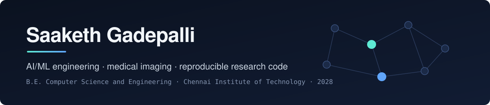
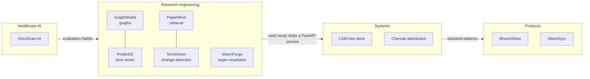

  

I'm a third-year Computer Science and Engineering student at Chennai Institute of Technology. I build machine-learning systems and try to be strict about how they are evaluated: leak-audited splits, multiple seeds, confidence intervals, and a status table in every repository that says what was actually run and what was not.

My starting point was explainable deep learning for cancer screening. The more recent work applies the same discipline to graphs, time series, retrieval and satellite imagery, with each study shipped as data package → model package → small HTTP service.

  
  
  

## Research engineering

Each of these is three installable Python packages with one-way dependencies, unit tests, continuous integration (CI), and a README that separates measured results from untested code paths.

| Project | Question it studies | Built from scratch | Data |
|---|---|---|---|
| [**GraphShield**](https://github.com/saaki05/project-1-) | Is the gap between graph neural networks and gradient boosting on fraud detection real once splits are audited for leakage? | GCN, GraphSAGE and GAT layers checked against PyTorch Geometric; drift reports | Amazon fraud graph |
| [**PredictIQ**](https://github.com/saaki05/project-2) | Do conformal prediction intervals for remaining useful life keep their coverage under operating-condition shift? | Split, normalized and binned conformal methods; LSTM, GRU, TCN, Transformer | NASA C-MAPSS |
| [**PaperMind**](https://github.com/saaki05/project-3) | Which retrieval components beat a tuned BM25 baseline on scientific claims, under paired significance tests? | BM25, RM3, LSA, dual encoder, rank fusion, bootstrap tests | SciFact |
| [**TerraVision**](https://github.com/saaki05/project-4) | How much do random tile splits inflate change-detection scores, and does self-supervised pretraining help with few labels? | Siamese U-Nets, contrastive pretraining, blocked splits with leakage audit | SpaceNet 7 |
| [**VisionForge**](https://github.com/saaki05/project-5) | Under a fixed, reported compute budget, how do regression, adversarial and diffusion super-resolution compare? | EDSR, GAN fine-tuning, residual diffusion, PSNR/SSIM | SpaceNet 7 |

All five were trained on CPU only. GPU runs, more seeds and the remaining benchmarks are listed as open work in each README.

## Healthcare AI

| Project | What it does |
|---|---|
| [**OncoScan-AI**](https://github.com/saaki05/oncoscan-ai) | One entry point for three screening models: leukemia classification from blood smears (CNN with CBAM attention), colorectal polyp segmentation (CLAHE enhancement and U-Net), and multi-cancer histopathology classification (transfer learning). A router network picks the model, Grad-CAM explains the prediction, and low-confidence cases are flagged for expert review. Research project, not a medical device. |

## Systems and products

| Project | What it does | Stack |
|---|---|---|
| [**LSM-tree key-value store**](https://github.com/saaki05/grandmaster) | Storage engine with write-ahead log, memtable, SSTables with sparse index, Bloom filters and streaming compaction; crash-recovery tests | Python |
| [**Chennai Insights Dashboard**](https://github.com/saaki05/chennai-insights-dashboard) | Traffic dashboard on the real Chennai road network with DBSCAN hotspot detection and short-horizon forecasts; simulated feed, refreshed by a scheduled workflow · [live](https://saaki05.github.io/chennai-insights-dashboard/) | FastAPI, Leaflet, GitHub Actions |

Also: [BhoomiSetu](https://github.com/saaki05/bhoomisetu-app-), a farmer-to-buyer marketplace (Flutter, Node.js, Supabase), and [SilentSync](https://github.com/saaki05/SilentSync), an offline sign ↔ text ↔ voice communication aid (Flutter).

## Interests

Evaluation methodology and distribution shift, explainable medical imaging, uncertainty estimation, storage and distributed systems, and getting research models into small, monitored services.

## How the work fits together

## Toolbox

  

- **Machine learning:** PyTorch, TensorFlow/Keras, scikit-learn, XGBoost; convolutional networks, U-Net, graph neural networks, sequence models, diffusion; Grad-CAM; conformal prediction
- **Evaluation:** temporal and spatially blocked splits, leakage audits, bootstrap confidence intervals, paired permutation tests
- **Backend:** FastAPI, Flask, Express, REST, WebSockets, PostgreSQL, MySQL, SQLite, MongoDB
- **Languages:** Python, Java, C++, JavaScript, Dart

## Experience

- **Software Development Intern, Siddi Vinayaka Mobikes Pvt. Ltd.** (April to June 2026). Built the browser-based vehicle movement tracker the dealership uses, on Google Sheets and Apps Script.
- **AI/ML developer, Fintech Centre of Excellence, Chennai Institute of Technology** (December 2025 to present). Explainable deep learning for diagnostics and Flask inference APIs.
- **Organiser, AI Engineering Club, Chennai Institute of Technology.**

## Problem solving

Blue-rated on CodeChef with 1,200+ problems solved, and 350+ on LeetCode.

---

Open to research internships and collaboration on evaluation-focused machine learning. The fastest way to reach me is [LinkedIn](https://linkedin.com/in/saaketh-gadepalli-648a3b325).
