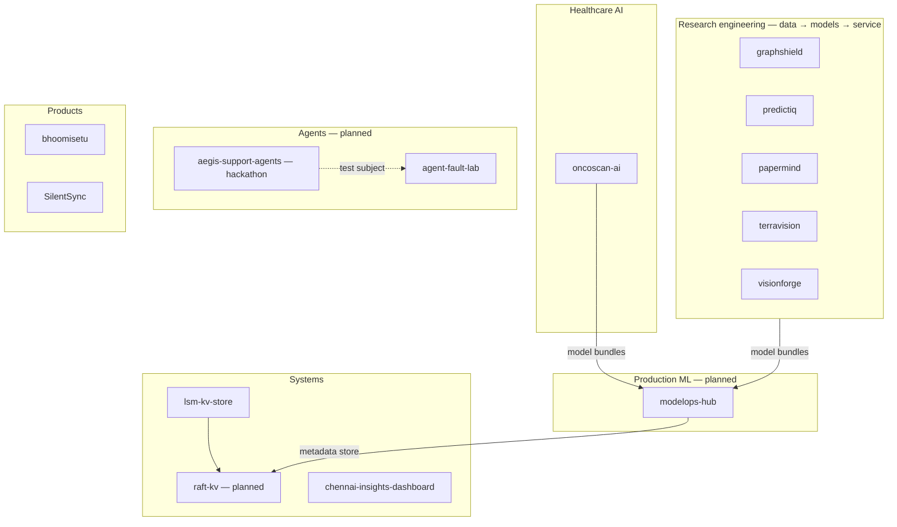

# Portfolio architecture

Shared conventions already present in the research repositories, to be carried to the rest: three packages with one-way dependencies, `pyproject.toml` per package, `ruff`, `pytest`, a `ci.yml` workflow, a status table in the README, results generated from JSON into `REPORT.md`.

Products and the dashboard stay separate; they are not forced into the model pipeline.
